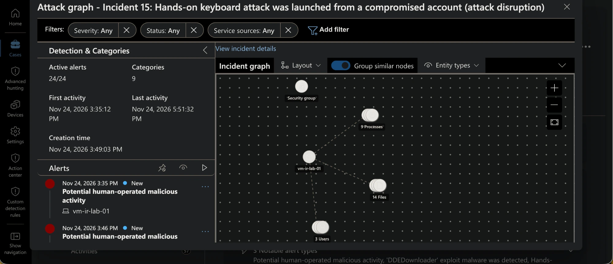
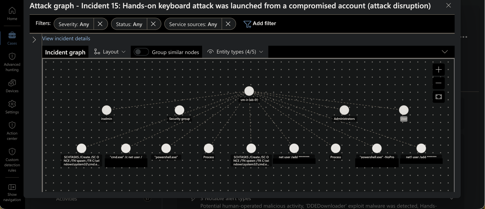
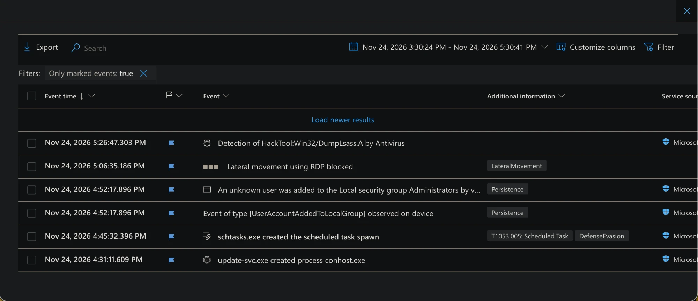

# Investigation walkthrough — IR-2026-FIN042

Starts from the alert only. Every timestamp, screenshot and query result below comes
from the real run (2026-11-24). Until then: `[placeholder]`.

Times are UTC. The portal shows AEDT (UTC+11, 12-hour clock); convert before pasting
a time into KQL, which uses UTC.

Details and raw query results: `live-response-post-attack.md` and `../detections/README.md`.

## Method: which tool answers which question

| Question | Tool | Why |
|----------|------|-----|
| Do these alerts belong to one attack? | Incident correlation / attack story | Defender groups alerts that share entities into one incident and orders them into the attack story; confirm the chain is one incident, and link any alert it did not pull in |
| Which entities does this incident involve? | Incident graph (Defender portal) | Shows alerts, devices, accounts, processes and files already correlated, with no multi-table join |
| What happened on the host, in order? | Device timeline | Process, registry, network and logon events in time order; flag the key events so they collect into a filtered view, which saves re-finding them and seeds the report timeline |
| Did the same account or file show up anywhere else? | Advanced hunting | Searches all raw events, including activity that never raised an alert |

The graph is the starting point; hunting confirms the scope. The graph only holds what
Defender already correlated into the incident, so it cannot prove that nothing else happened.

**Limit of this lab:** there is one device, so the graph is small. In a real intrusion
with lateral movement, the graph would show the path across hosts, and that is where it
saves the most time compared with writing the joins by hand.

## 1. Triage: the first alert

- Incident 15 on `vm-ir-lab-01`. It first held the Atomic Red Team download alerts
  (04:47:31: PowerSploit, ShellCode, DDEDownloader, Empyre, ransomware-linked actor) on
  files under `C:\AtomicRedTeam\`. These are the test tool's own files, so I set them
  aside as install noise.
- First alert from the attack chain: **"Masqueraded task or service"**, Low, 05:45:32.
  File evidence `C:\Windows\System32\cmd.exe`, account `iradmin`.
- One second later, two High alerts: "Hands-on-keyboard attack involving multiple
  devices" and "Compromised account conducting hands-on-keyboard attack" (05:45:33).
  The "Potential human-operated malicious activity" alert at 05:45:33 carries the process
  chain `powershell.exe` → `cmd.exe /c SCHTASKS /Create /SC ONCE /TN spawn /TR
  C:\windows\system32\cmd.exe /ST 20:10` → `schtasks.exe`.
- First read: a signed-in admin account (`iradmin`, RID 500) is running commands by hand
  from an interactive PowerShell, and has just created a one-time task that starts
  `cmd.exe`. Treat the account as compromised and the host as hands-on-keyboard.
- Attack disruption reached the same conclusion: it contained `iradmin` at 05:58:59
  (`LMFContainUser`, Action center) and renamed the incident at 06:01:16 to "Hands-on
  keyboard attack was launched from a compromised account (attack disruption)".
- Three "Potential human-operated malicious activity" alerts start before the attack
  (first activity 04:35:12 in the alert export, before the first RDP sign-in at 04:41).
  The earliest (alert time 04:38:16) has no process, file or user evidence: only the
  device, with verdict Suspicious, and the Azure VM resource. The device verdict was
  re-analysed at 06:04:26–06:04:41, after containment. Incident 15's Activities show
  alerts with this title correlated into the incident at 05:59:12, 06:04:27 and
  06:36:50, the first one 13 seconds after the contain at 05:58:59.
  Reading: this is a device-level summary alert that Defender keeps re-scoring as the
  attack goes on, not a separate event before the attack. Its start time is the start
  of the device's activity window, not an attacker action. Why the window starts at
  04:35 is not confirmed (the VM booted at about 04:36). For triage it adds nothing the
  step alerts do not already show.

## 2. Attack story: four steps, one incident

A real multi-stage intrusion shows up as several alerts, not one. The first check is
whether this chain landed as a single incident. Defender XDR correlates alerts that share
entities (the device, the account, the process lineage) into one incident and lays them
out as the attack story, so the stages read as one attack instead of four unrelated hits.

- Alerts in the incident: 20 at the first export, 24 after phase 5. Built-in alerts
  cover steps 2, 3 and 4:
  - Step 2: "Masqueraded task or service" (05:45:32), plus the High hands-on-keyboard
    alerts (05:45:33).
  - Step 3: "Suspicious account creation", "Suspicious Windows account manipulation",
    "Suspicious behavior by cmd.exe was observed", "New local admin added using Net
    commands" (all 05:52:17).
  - Step 4: "An active 'RundllLolBin' malware in a command line was prevented from
    executing" (Low, 06:02:58) and "An active 'DumpLsass' hacktool in a command line was
    prevented from executing" (Medium, 06:26:47).
  - Containment side effect: "Lateral movement using RDP blocked" (Informational,
    06:06:35, tag Attack Disruption).
  - **Step 1 had no built-in alert.** The payload download and start at 05:31:10 only
    became an alert after I wrote custom rule 1.
- Correlated automatically, or did I link any by hand?
  - Every built-in alert joined incident 15 by itself ("Same device, Same user
    credentials"; the Atomic AV alerts on "Same device" only).
  - Custom rules 1 and 3 joined 15 by correlation. Rule 1's correlation reason is
    "Same device" only, and its account shows as a SID, not `iradmin`.
  - Custom rules 2 and 4 opened their own incidents (16, 21, 22): incident correlation
    was off on those rules. I turned it on and linked their 3 alerts into 15 by hand
    ("Link alert to another incident"). 20 → 21 (tuned rule 3) → 24 (3 linked).
  - Note (phase 6, 2026-11-25): the incident now holds 26 alerts. The two extra are the
    Custom TI alerts from the phase 6 indicator test, correlated automatically at
    09:29:26 and 09:39:29 UTC (`response.md`, steps 4 and 5). The 24 above is the count
    after phase 5.
- Attack story order vs. the real chain: the alerts follow the real order, step 2
  (05:45) → step 3 (05:52) → step 4 (06:02, 06:26). Step 1 (05:31) appears only through
  the custom rule. The story also shows what the chain did not plan: step 4 ran twice,
  once before and once after the RDP session was dropped by containment.

The attack story only holds what Defender already correlated, so it does not prove nothing
else happened — section 4 confirms scope with hunting.

### Incident graph



Taken 2026-11-25, "Group similar nodes" on. Panel: 24/24 active alerts, 9 categories,
first activity 04:35:12, last activity 06:51:32, incident created 04:49:03 (UTC).

| Node | Entity | Notes |
|------|--------|-------|
| `vm-ir-lab-01` | Device | The only device. Every other node links to it |
| 3 Users | Account | `iradmin` (RID 500) ran every step and was contained at 05:58:59. Custom rule 1 shows it as a SID. The other two: `Administrators` (the group, also listed as a user entity) and one shown only as "User". The "New local admin added using Net commands" alert names a RID 1000 SID next to `iradmin` and `Administrators`, and "User" is that SID with no name resolved (node details, 2026-11-25). `UserAccountCreated` at 05:52:17 gives `t1136.001_admin` the same RID 1000, so "User" is the new account. It never appears by name in the graph |
| 9 Processes | Process | Includes `powershell.exe` PID 6520 (04:44:48) and PID 4008 (06:09:35), one interactive console per RDP session |
| 14 Files | File | Atomic Red Team test files (install noise), `cmd.exe` (step 2), `update-svc.exe` (step 1), ProcDump (step 4) |
| Security group | Group | `Administrators`, from the step-3 alert "New local admin added using Net commands" |

Ungrouped, with files hidden (Entity types 4/5), the graph names each node: `iradmin`,
the unnamed "User" (`t1136.001_admin`), `Administrators`, and the step 1–3 command lines
around `vm-ir-lab-01`. Password and base64 redacted in the screenshot:



One device and no edge to another host: the graph alone already suggests one host.
Section 4 checks that with hunting.

## 3. From the graph to hunting

- Entity I pivoted on: `iradmin` (RID 500), from the Users node. "Go hunt" has three
  options: all available queries, activity, related alerts. I used **activity**.
- "Go hunt" query generated by the portal (SID replaced here):

  ```kql
  let accountSid = "[iradmin SID]";
  let accountName = "iradmin";
  let selectedTimestamp = datetime(2026-11-24T04:35:12.4830000Z);
  search in (DeviceProcessEvents,DeviceNetworkEvents,DeviceFileEvents,DeviceRegistryEvents,DeviceLogonEvents,DeviceImageLoadEvents,DeviceEvents,BehaviorEntities)
  Timestamp >= selectedTimestamp
  and (// Events initiated by this account
  AccountSid =~ accountSid
  //or InitiatingProcessAccountSid =~ accountSid
  //or AccountName =~ accountName
  //or InitiatingProcessAccountName =~ accountName
  // Events affecting the target account
  )
  | take 100
  ```

  The start time is the incident's first activity (04:35:12).
- What it returned (100 rows, 04:41:05–06:26:34): 86 `ProcessCreated`, 10 `LogonSuccess`
  (the two RDP sign-ins, 04:41 and 06:07), and 4 `DeviceEvents`:
  - **06:06:35 `ContainedUserRemoteDesktopSessionDisconnected` and
    `ContainedUserRemoteDesktopSessionStopped`, session 2.** This is the containment
    ending the first RDP session. Until now that was an inference from timing (alert at
    06:06:35, `Temp\2` deleted at 06:06:37); this event shows it directly.
  - 06:06:37 `NamedPipeEvent` by `winlogon.exe` in session 2 (`wkssvc`): session teardown.
  - 06:26:26 `SensitiveFileRead` on `C:\AtomicRedTeam\ExternalPayloads\Procdump.zip`
    by the PowerShell that downloaded it (step-4 prereq).
- What was wrong with it:
  - `take 100` returns an arbitrary 100 rows, not the first or the most important.
    None of the step 1–3 processes (`schtasks`, `net`, `update-svc.exe`) were in the
    100; most rows were session noise (`taskhostw`, `conhost`, `RuntimeBroker`).
  - It matches `AccountSid` only. `InitiatingProcessAccountSid` is commented out, so
    files, registry and network events written by `iradmin`'s processes are missed
    (no `DeviceFileEvents` rows, so no `update-svc.exe` write).
  - No end time.
- What I changed and why: enabled `InitiatingProcessAccountSid`, bounded the window to
  04:30–07:00, and replaced `take 100` with a summary by table and `ActionType`, so every
  kind of activity shows once instead of a random sample. Kept SID matching, not name.

  ```kql
  let sid = toscalar(DeviceLogonEvents
      | where DeviceName =~ "vm-ir-lab-01" and AccountName =~ "iradmin"
      | distinct AccountSid | take 1);
  union withsource=Table
      DeviceProcessEvents, DeviceLogonEvents, DeviceFileEvents,
      DeviceRegistryEvents, DeviceNetworkEvents, DeviceEvents
  | where Timestamp between (datetime(2026-11-24 04:30) .. datetime(2026-11-24 07:00))
  | where AccountSid == sid or InitiatingProcessAccountSid == sid
  | summarize Events = count(), First = min(Timestamp), Last = max(Timestamp)
      by Table, ActionType, DeviceName
  | order by Table asc, Events desc
  ```

- Result (run 2026-11-25): 28 rows, all on `vm-ir-lab-01`. The ones that matter
  (UTC, 2026-11-24):

  | Table | ActionType | Events | First | Last | What it is |
  |---|---|---|---|---|---|
  | DeviceNetworkEvents | ConnectionSuccess | 12 | 04:41:21 | 05:31:10 | Last one is the step-1 download |
  | DeviceEvents | ScheduledTaskCreated | 1 | 05:45:32 | 05:45:32 | Step 2, `\spawn` |
  | DeviceEvents | UserAccountCreated | 1 | 05:52:17 | 05:52:17 | Step 3 |
  | DeviceEvents | UserAccountModified | 1 | 05:52:17 | 05:52:17 | Step 3 |
  | DeviceEvents | UserAccountPasswordResetAttempt | 1 | 05:52:17 | 05:52:17 | Step 3 (password set) |
  | DeviceEvents | UserAccountAddedToLocalGroup | 2 | 05:52:17 | 05:52:17 | Step 3: `Builtin\Users` (default for a new account) and `Builtin\Administrators` (`AdditionalFields.GroupName`) |
  | DeviceEvents | OtherAlertRelatedActivity | 12 | 05:45:32 | 06:26:47 | Same span as the step 2–4 alerts |
  | DeviceEvents | ContainedUserRemoteDesktopSession Disconnected / Stopped | 1 + 1 | 06:06:35 | 06:06:35 | Containment ends RDP session 2 |
  | DeviceFileEvents | FileRenamed | 2 | 06:06:35 | 06:06:35 | Same second as the session stop: Server Manager saving `user.config` and `ServerList.xml` as the session closed. Noise |
  | DeviceLogonEvents | LogonSuccess | 10 | 04:41:05 | 06:07:24 | The two RDP sign-ins |
  | DeviceEvents | SensitiveFileRead | 2 | 04:45:50 | 06:26:26 | Last one is `Procdump.zip` |
  | DeviceEvents | PowerShellCommand | 237 | 04:41:47 | 06:26:34 | Every typed or scripted command, steps 1–4 included |

  The rest is session and tool-install noise: `AntivirusDetection` 85 (04:46:41–04:47:24,
  Atomic download), `BrowserLaunchedToOpenUrl` 65, `ClrUnbackedModuleLoaded` 40,
  `NtProtectVirtualMemoryApiCall` 27, `ProcessPrimaryTokenModified` 12,
  `ShellLinkCreateFileEvent` 7, `NamedPipeEvent` 6, `DpapiAccessed` 5,
  `CreateRemoteThreadApiCall` 4, `GetClipboardData` 3 (RDP clipboard),
  `NtAllocateVirtualMemoryApiCall` 3, `FileCreated` 600, `FileDeleted` 1 (04:52:34),
  `ProcessCreated` 148, `RegistryValueSet` 13.
- What it changed: the step-3 account events exist. An earlier device-wide `DeviceEvents`
  query (2026-11-24) returned no `UserAccount*` action types; this account-scoped query
  returns four. A device-wide rerun on 2026-11-25 (05:50–05:55, `ActionType startswith
  "UserAccount"`) returns all five rows too: `t1136.001_admin` created, modified and
  password set, and two group adds, all by `iradmin`. So the events were there on a
  device-wide query; the first result was misread or incomplete (see section 6).

What hunting found that the alerts did not (queries run 2026-11-24, window 04:30–07:00):

- **Step 1.** `DeviceEvents` `PowerShellCommand` showed the decoded command:
  `Invoke-WebRequest` from the lab storage account into
  `C:\Users\iradmin\AppData\Local\Temp\2\update-svc.exe`, then `Start-Process`.
  The process command line only had `-EncodedCommand [base64]`.
- **Step 4.** Neither dump command has a process event; both were blocked before the
  process was created. `PowerShellCommand` events show the two attempts:
  `Invoke-AtomicTest T1003.001 -TestNumbers 2` (06:02:42) and `-TestNumbers 1` (06:26:32).
- **Step 3.** `DeviceProcessEvents`: `net user /add` and `net localgroup administrators
  "T1136.001_Admin" /add` (05:52:17). New account `T1136.001_Admin`; no logon since.
  `DeviceEvents` also has `UserAccountCreated`, `UserAccountModified`,
  `UserAccountPasswordResetAttempt` and two `UserAccountAddedToLocalGroup` at 05:52:17
  (found 2026-11-25 with the account-scoped query above; the first search missed them).
- **Session drop.** `DeviceEvents` at 06:06:35: `ContainedUserRemoteDesktopSessionDisconnected`
  and `ContainedUserRemoteDesktopSessionStopped` for session 2, so containment ended the
  first RDP session. `DeviceLogonEvents`: `iradmin` signed in again over RDP at 06:07:24,
  49 seconds later. `DisruptionAndResponseEvents` has only the two 06:06:35 session events and no `ContainedUserLogonBlocked`, although the policy is still Active: the new sign-in was never blocked. Cause not confirmed.

## 4. Scope check: the join the graph does for you

Query: [`hunting/scope-check.kql`](hunting/scope-check.kql). It takes the incident's alert
evidence (accounts and file hashes) and looks for them on every device: successful logons
by those accounts, and processes with those hashes.

Run 2026-11-25. The query takes every alert with evidence on `vm-ir-lab-01` in
04:30–07:00 on 2026-11-24 (incident 15), and searches from 04:30 on 2026-11-24 to now.
Accounts match on SID, files on SHA1 or SHA256.

- Result:

  | Device | Other device | Source | Events | First (UTC) | Last (UTC) |
  |---|---|---|---|---|---|
  | `vm-ir-lab-01` | No | Process | 36 | 04:35:32 | 06:47:05 |
  | `vm-ir-lab-01` | No | Logon Network | 5 | 04:41:05 | 06:07:23 |
  | `vm-ir-lab-01` | No | Logon RemoteInteractive | 5 | 04:41:09 | 06:07:24 |
  | `vm-ir-lab-01` | No | File FileCreated | 5 | 05:10:22 | 06:26:26 |

- Conclusion: no row on any other device. No other device had a successful logon by
  the incident's accounts, or a process or file with the incident's hashes. Scope is
  one host.
- Reading the rows:
  - The logons are the two RDP sessions (04:41 and 06:07); the last one matches the
    re-logon after containment. No logon by `T1136.001_Admin`.
  - The process hashes include common binaries from the alert evidence (`cmd.exe`,
    `powershell.exe`), so most of the 36 events are normal use of those tools, up to
    live response at 06:47.
  - The file rows end at 06:26:26 (ProcDump written). The first, 05:10:22, is before
    step 1: `C:\simulation\payload-stub\stub.exe`, written by `csc.exe` (the .NET C#
    compiler) as `iradmin`. Its SHA256 is `8765f0fe…de66e`, the same as `update-svc.exe`
    (05:31:11), so it is the step-1 payload, compiled on the VM. The step-1 download
    pulled a blob also named `stub.exe`.
  - `C:\simulation` arrived at 05:09:34, written by `explorer.exe` (copied in over the
    RDP session): `run-chain.ps1`, `payload-stub\build-stub.ps1` and `atomics\T1059.001`.
    It was not in the live response `dir C:\` at 06:49, and no `FileDeleted` exists for
    it. `C:\lab` was created at 05:30:06 and the operator ran `cd C:\lab\simulation` at
    05:31:05, so the folder was moved into `C:\lab` (MDE does not log folder moves).
    Confirmed in phase 6: `stub.exe` is at `C:\lab\simulation\payload-stub\`.
- Limit: the hash match is strong only if other onboarded devices exist. With one device
  in the tenant, "no other device" is true by default. [number of devices in
  `DeviceInfo` over the same window]

## 5. Device timeline: rebuilding the chain

On the device page, the timeline lists every recorded event in order. Working through it,
I **flag** each event that belongs to the intrusion (the flag button on the event). The
timeline then filters to flagged events only, so the chain stands on its own without
re-reading everything, and the rows below — and the report's timeline — are built straight
from that flagged set. Flags complement hunting: hunting finds events by a condition across
devices, the timeline reads one host in order and flags the ones that matter.

- Events flagged: 6 events, one per step plus containment (2026-11-25). I reached each
  one from its alert with "See in timeline" instead of searching the timeline:

  | Time (UTC) | Step | Timeline event |
  |---|---|---|
  | 05:31:11 | 1 | `update-svc.exe` created process `conhost.exe` |
  | 05:45:32 | 2 | `schtasks.exe` created the scheduled task `spawn` |
  | 05:52:17 | 3 | "An unknown user was added to the Local security group Administrators" and `UserAccountAddedToLocalGroup` |
  | 06:06:35 | Containment | Lateral movement using RDP blocked |
  | 06:26:47 | 4 | Detection of `HackTool:Win32/DumpLsass.A` by Antivirus |

  

  The timeline also calls the new account an "unknown user", the same as the graph's
  unnamed "User" node.
- Why only six: the timeline flags one event at a time, with no bulk action, so flagging
  every row below by hand would cost more than it saves. Hunting built the full table;
  the flags mark the steps for anyone opening the device page.

The rows below come from hunting.

| Time (UTC) | Step | Event | Source table |
|------------|------|-------|--------------|
| 04:41:14 | - | First RDP session: `explorer.exe` PID 2360 for `iradmin` | DeviceProcessEvents |
| 04:44:48–04:47:31 | - | PowerShell PID 6520 starts; NuGet provider and Atomic Red Team install (noise) | DeviceProcessEvents, DeviceFileEvents |
| 05:09:34 | - | Operator scripts copied in to `C:\simulation` (`run-chain.ps1`, `build-stub.ps1`) | DeviceFileEvents |
| 05:10:22 | 1 T1059.001 | `csc.exe` compiles `stub.exe`, same SHA256 as the later `update-svc.exe` | DeviceFileEvents |
| 05:31:10 | 1 T1059.001 | Encoded PowerShell (PID 5488) downloads `update-svc.exe` into `Temp\2` | DeviceEvents (PowerShellCommand) |
| 05:31:11 | 1 T1059.001 | `update-svc.exe` written and started | DeviceFileEvents, DeviceProcessEvents |
| 05:45:32 | 2 T1053.005 | `schtasks /Create /SC ONCE /TN spawn /TR cmd.exe` | DeviceProcessEvents |
| 05:52:17 | 3 T1136.001 | `net user /add`, then `net localgroup administrators "T1136.001_Admin" /add` | DeviceProcessEvents |
| 05:58:59 | Response | Attack disruption contains `iradmin` | Action center |
| 06:02:42–48 | 4 T1003.001 | Test 2 (`rundll32`/comsvcs) judged malicious and blocked | DeviceEvents (PowerShellCommand), AlertEvidence |
| 06:06:35–37 | Response | RDP blocked; `ContainedUserRemoteDesktopSessionStopped` for session 2; `update-svc.exe` deleted with `Temp\2` | AlertInfo, DeviceEvents, DeviceFileEvents |
| 06:07:24 | - | `iradmin` signs in again over RDP | DeviceLogonEvents |
| 06:26:26 | 4 T1003.001 | ProcDump downloaded into `C:\AtomicRedTeam\ExternalPayloads\` | DeviceFileEvents |
| 06:26:32–38 | 4 T1003.001 | Test 1 (ProcDump) judged malicious and blocked | DeviceEvents (PowerShellCommand), AlertEvidence |

## 6. Wrong turns

- **Expected a step-1 alert.** I assumed a download-and-run from PowerShell into Temp
  would alert. Nothing fired, and no alert holds the payload as evidence. Fix: custom
  rule 1 on the file write.
- **Concluded there was no account-creation event.** On 2026-11-24 a device-wide
  `DeviceEvents` query listed 36 action types in the window and none were account
  events, so I wrote "MDE has no `UserAccountCreated` here" and built rule 3 on
  `DeviceProcessEvents` (`net` / `net1`). On 2026-11-25 the account-scoped query in
  section 3 returned `UserAccountCreated`, `UserAccountModified`,
  `UserAccountPasswordResetAttempt` and two `UserAccountAddedToLocalGroup` at 05:52:17.
  The first result was wrong. A device-wide rerun of the same window on 2026-11-25
  returns the same five events, and the first query (`DeviceEvents`, device and window
  filter, `summarize count() by ActionType`) was written correctly. Its result was kept
  only as a screenshot, so I cannot tell whether I read a partial view or the events
  had not been ingested yet (the query ran about 4.5 hours after the attack). Lesson: a
  "no rows" result is a finding to re-check with a second query, not a fact, and query
  results go in a CSV, not only a screenshot. Rule 3 still
  works on process events; an account-event rule would also catch PowerShell
  `New-LocalUser`, which rule 3 misses.
- **Trusted MDE's masking.** MDE replaced the account name in `net user /add` with
  `**********` and left the password in clear text. The account name had to come from
  the `localgroup` command, and the password is kept out of notes and screenshots.
  The incident graph does the same: the ungrouped process nodes show the password in
  clear text on three labels (`cmd.exe /c net user /add`, `net user /add`,
  `net1 user /add`). Anyone who can open the incident can read it. Screenshots of the
  graph need redaction before they leave the portal.
- **Expected process events for the dumps.** Both attempts were blocked before the
  process started, so there is no `rundll32` or `procdump` process with `lsass`. Rule 4
  branch A can not be verified; branch B (ProcDump written to disk) can.
- **Looked for `C:\lab` contents in file events.** MDE logs no folder creation and no
  file event under `C:\lab`. The contents came from a hash search instead: the files
  were written to `C:\simulation` at 05:09:34 and the folder was moved into `C:\lab`
  at about 05:30 (confirmed in phase 6). Searching by hash and file name found what a folder search
  could not.
- **Filtered `AlertInfo` on the time the alert was raised.** No rows. For backfilled
  custom alerts, `AlertInfo.Timestamp` is the event time (05:31–06:26), not the raise
  time (11:38–11:55). The portal's 12-hour AEDT clock made the mix-up easier.
- **Assumed entity mapping would correlate custom alerts.** Rules 2 and 4 opened their
  own incidents. Incident correlation is a separate per-rule setting; I turned it on and
  linked the alerts by hand.
- **One action, four alerts.** Rule 3 raised one alert per row (`net` and `net1`, two
  commands). Fix: collapse rows by device, account and 5-minute window.
- **Thought "Go hunt" did nothing.** It does not open a new page: the results load
  below the incident graph, out of view until the page is full screen and scrolled.
  The first CSV export from there was empty (100 blank lines); "Open in advanced
  hunting" and exporting from there worked.
- **Thought missing columns meant missing data.** The results view shows a default
  set of columns picked from the query ("Customize columns" adds the rest), and the
  portal says so in a pop-up on the first run. The CSV export has every column. What
  the Go hunt result really missed came from the query (`take 100`, one SID field),
  not from the view.
- **Took the "Go hunt" result as the account's full activity.** It ends in `take 100`
  and matches only `AccountSid`, so it showed a random sample and missed every file the
  account's processes wrote. See section 3.
- **Reused an old test rule.** The first custom alerts were titled "TEST reg query
  HKCU": the title field came from the capability-test rule. Fixed for new alerts; old
  alerts keep the title.
- **Assumed containment ends the attacker's access.** `LMFContainUser` at 05:58:59 did
  not stop the first dump attempt in the open session (06:02:42), and `iradmin` signed
  in again over RDP 49 seconds after the session was dropped. Device isolation or
  disabling the account would have been needed. `DisruptionAndResponseEvents` shows no blocked logon at 06:07, and the policy is still Active today. Containment logged off the open session; it did not stop a new RDP sign-in from a device outside MDE.
